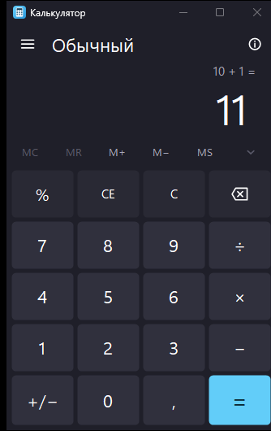

# Калькулятор для Windows 11

Простой калькулятор в стиле стандартного приложения Windows 11: тёмная тема, крупный дисплей, кнопки со скруглёнными углами и голубая кнопка «=». Только базовые операции — без инженерных функций.



## Возможности

- Сложение, вычитание, умножение и деление.
- Проценты, смена знака, удаление последнего символа (⌫), `CE` и `C`.
- Память: `MC`, `MR`, `M+`, `M−`, `MS` и список сохранённых значений.
- Цепочка вычислений выполняется последовательно, как в стандартном калькуляторе (`5 + 3 × 2` даёт `16`); повторное `=` повторяет последнюю операцию.
- Группировка разрядов, запятая как десятичный разделитель, сообщение при делении на ноль.
- Управление с клавиатуры: цифры, `+ − * /`, `Enter`, `Backspace`, `Esc`, `Delete`, `%`, `F9`, `Ctrl+C` (копировать результат).
- Масштабирование под DPI и изменение размера окна.

## Запуск

Готовый файл — `Calculator.exe`. Просто откройте его двойным щелчком.

Приложение написано на C# для .NET Framework 4.8, который входит в Windows 11, поэтому ничего устанавливать не нужно. Исполняемый файл самодостаточен и не требует установки.

## Сборка из исходников

Нужен только Windows: компилятор C# уже есть в составе системы.

```powershell
git clone https://github.com/<ваш-ник>/<репозиторий>.git
cd <репозиторий>
powershell -NoProfile -ExecutionPolicy Bypass -File .\build.ps1
```

Собрать и сразу запустить:

```powershell
powershell -NoProfile -ExecutionPolicy Bypass -File .\build.ps1 -Run
```

В Visual Studio Code: `Ctrl+Shift+B` — сборка, задача «Запустить калькулятор» — запуск, задача «Тесты движка» — проверки арифметики.

## Тесты

```powershell
powershell -NoProfile -ExecutionPolicy Bypass -File .\tests\run-tests.ps1
```

Проверки покрывают арифметику, проценты, память, поведение после `=`, деление на ноль и форматирование чисел.

## Структура проекта

| Файл | Назначение |
| --- | --- |
| `src/Program.cs` | Точка входа |
| `src/MainWindow.cs` | Окно, раскладка кнопок, горячие клавиши, меню |
| `src/CalculatorEngine.cs` | Вся логика вычислений, независима от интерфейса |
| `src/CalcButton.cs` | Кнопка с собственными состояниями наведения и нажатия |
| `src/Theme.cs` | Цвета, шрифты, скруглённые формы |
| `src/DarkMenuRenderer.cs` | Тёмное оформление контекстных меню |
| `src/InfoForm.cs` | Окна «О программе» и «Горячие клавиши» |
| `src/Native.cs` | Тёмный заголовок окна Windows 11 и чтение раскладки клавиатуры |
| `tests/EngineTests.cs` | Тесты логики вычислений |
| `tools/make-icon.ps1` | Генерация `Calculator.ico` |
| `tools/screenshot.ps1` | Снимок окна для документации |
| `app.manifest` | Манифест: DPI-awareness, поддержка Windows 10/11 |

## Заметки

- Точность вычислений ограничена типом `decimal`: 28–29 значащих цифр, на экране до 16 цифр мантиссы.
- При переполнении или делении на ноль появляется сообщение, а следующее действие начинает новый расчёт.
- Кнопки `%`, `CE`, `C`, `⌫` работают как в стандартном калькуляторе Windows.

## Лицензия

[MIT](LICENSE)
